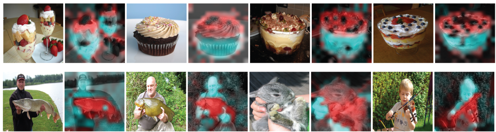
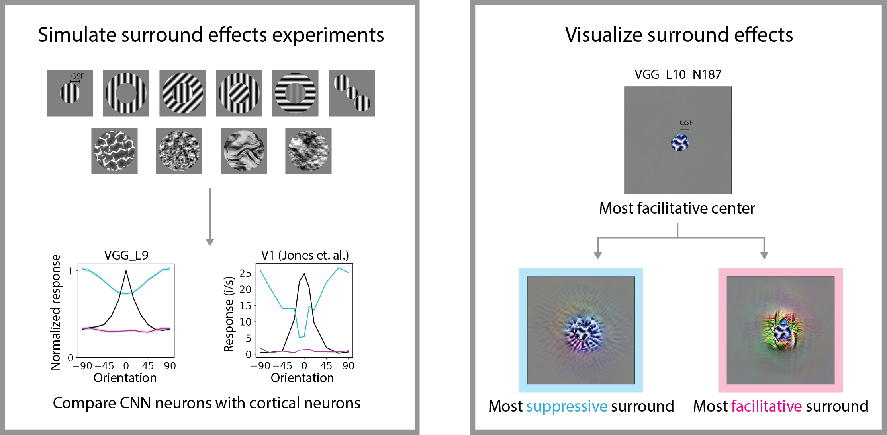
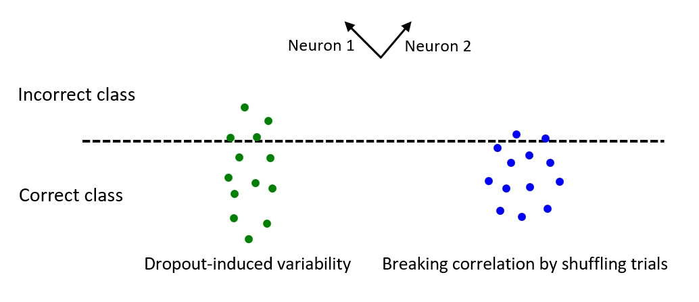

# Featured Research

&nbsp;

## Dissecting Query-Key Interaction in ViTs [[link](https://arxiv.org/abs/2405.14880)]

Token interactions in ViT can be better understood by singular value decomposing the query-key interaction matrix. Decomposed singular modes show surprising semantic properties. Further, in early layers self-attention prefers to group similar tokens; while in late layers self-attenion prefers dissimilar tokens indicating contextualization effects.

  

&nbsp;

## Contextual Surround Effects in CNNs [[link](https://journals.plos.org/ploscompbiol/article?id=10.1371/journal.pcbi.1011486)]

Vision perception at a given point is influenced by its surroundings ([an example](https://en.wikipedia.org/wiki/Visual_tilt_effects)). Many contextual surround effects boil down to [surround suppression](https://en.wikipedia.org/wiki/Surround_suppression), usually best captured by a division computation.

This study aims to find the role of surround effects in deep neural networks (DNNs) and use DNNs to predict the form of surround effects in high visual areas in the brain. CNNs show surprising alignment with many of the classic surround effects. The surround effects can be visualized using a modified feature visualization technique. The most supressive surround pattern appears to be similar to the center pattern. We see this as a generalized surround effect beyond classic findings with grating stimuli.

In another study [[link](https://www.biorxiv.org/content/10.1101/2021.05.20.445029v1)], we improve CNN classification accuracy by incorporating a brain-inspired weighted normalization.

  

&nbsp;

<!-- ## Dropout-Induced Variability in DNNs [[link](https://direct.mit.edu/neco/article-abstract/36/4/621/119783/Probing-the-Structure-and-Functional-Properties-of?redirectedFrom=fulltext)]

The structure of neural noise correlation influences coding efficiency. Some DNNs with dropout layers also have noisy activations. We study the detailed correlation structure of the dropout-induced variability in DNNs. Dropout-induced variability has similar structure as found in the brain (e.g. positive noise correlation, low-dimensionality). Breaking the correlation by shuffling trails increases classification accuracy.

  
 -->

